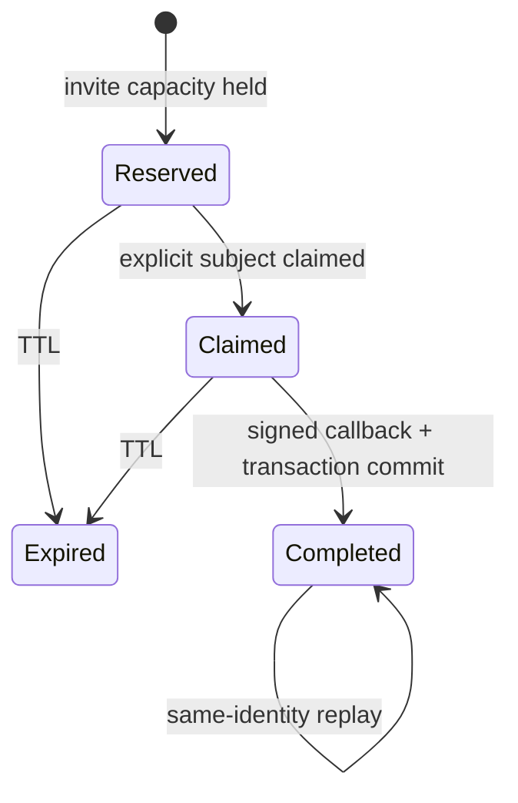
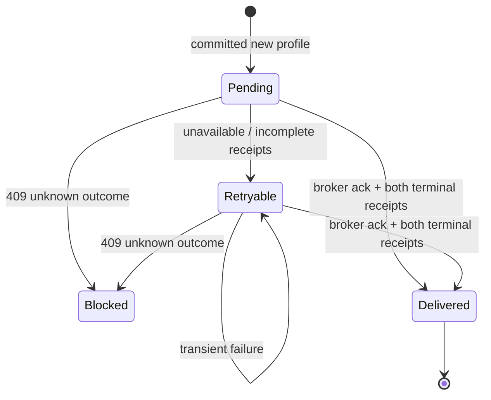

# State machines in 4orm

State lives at the boundary that owns it: durable facts in SQLite, signed sign-in
transactions in the browser session, ephemeral chat state in one server process,
and request state in the relevant browser control. Named enums and discriminated
unions describe multi-state lifecycles. Existing independent booleans remain
independent; for example, a thread can be both pinned and locked.

There is no second persisted `state` column to synchronize, no schema migration,
and no new state-machine service. SQL conditional writes and transactions still
own capacity, identity binding, grant reservations and terminal receipts. A state
selector describes those facts; it cannot authorize a mutation by itself.

## Authentication and enrollment

| Machine | States and transitions | Owner / invariant |
| --- | --- | --- |
| Browser sign-in transaction | missing → waiting → consumed; waiting → expired; malformed transaction → invalid; any callback consumes the transaction before validation | `app/oidc.py`: `SignInState`, `begin`, `complete`. State/nonce/PKCE/signature checks are required; invalid callbacks cannot reuse the transaction. Consumed is represented by removal, not a reusable token. |
| Browser member session | anonymous → authenticated → expired/invalid → anonymous | `SessionState`, `session_state`, `app/deps.py:current_user`. Missing/wrong issuer or invalid expiry never becomes a valid session; expiry clears the cookie. |
| Local account and trust | awaiting_trust → active; either enabled state ↔ disabled; deletion → absence | `app/queries/users.py:AccountState`, `account_state`; central callback, trust agreement and admin routes. Trust acceptance and administration are separate policies, not permissions inferred from the state name. Disabled accounts cannot authenticate. |
| Invitation | active → reserved when all remaining uses are held; reservation expiry → active; redemption → active/exhausted; time → expired; owner cancellation → disabled | `InviteState`, `invite_state`, `pending_reservations`. Disabled/expired precede remaining capacity. A pending signup prevents deletion even if no use has committed yet. Partial capacity can remain active. Settings displays the derived state. |
| Enrollment reservation | reserved → claimed → completed; reserved/claimed → expired; invite disable/delete/expiry makes pending work unavailable | `app/enrollment.py:EnrollmentState`. Claim binds exactly one central subject; repeat finish returns the same linked member during the valid callback window. SQL admission guards remain atomic. |
| New-profile commit | uncommitted → profile + explicit identity + invite usage + completion event, all in one transaction | `enrollment.finish`. Rollback leaves none of those effects. Existing-member enrollment consumes no invite use and creates no fanout event. |
| Completion proof | unavailable → committed; enabled ↔ disabled is checked separately | `enrollment_completion.proof/eligible`. Committed proof survives the invite/reservation TTL. No username/email linking. |
| Per-application grant receipt | absent → reserved → done | `GrantState`, `grant_state`, `reserve`, `finish`. First reservation's attempt ID wins. Created/preserved are immutable terminal outcomes. Replay never grants permissions again or repairs an externally deleted grant. |
| Broker delivery | pending → delivered/retryable/blocked; retryable → delivered/retryable/blocked; delivered and blocked stop automatic attempts | `DeliveryState`, `delivery_state`, `deliver`, `retryable_deliveries`. A 200 acknowledgment requires BOTH Maps and Burger terminal receipts. A 409 needs operator reconciliation, not another grant write. Profile/invite commit survives a broker outage. |
| API authentication | unauthenticated/invalid → 401; provider unavailable → 503; valid human member + operation scope/role + local ownership → authorized | `app/central_api.py`, `require_api_user`. Authenticated introspection remains scope/revocation authority; roles alone are insufficient. Each request is checked afresh. |
| CLI browser login | discover → wait for callback → exchange → verify signed identity → persist → logged in; denial/timeout/error terminate without saving credentials | `cmd/4orm/main.go:login`, `central.go`. Incorrect state leaves the listener waiting; the loopback listener closes on exit. |
| CLI request/refresh | `initialRequest` → success/error or refresh → `retriedRequest` → success/error | `requestAttempt`, `doWithToken`, `refresh`. At most one refresh/retry; a second 401 is terminal. Only matching central issuer/client credentials may refresh. |
| CLI credential storage | absent → saved central credentials → rotated central credentials; legacy/mismatched credentials → explicit new-login requirement | `loadCredentials`, `saveCredentials`, `refresh`. Save succeeds before the in-memory credential pair is replaced. No old-issuer token import. |
| CLI self-update | discover release → select platform → download → checksum → extract → replace; failure leaves existing executable | `cmd/4orm/main.go`. Version/checksum/archive validation and supported-platform checks stay in place. |

## Browser interaction and realtime state

| Machine | States and transitions | Owner / observable behavior |
| --- | --- | --- |
| Quick upload | idle → pending → success/error; error → pending on retry | `src/lib/media.ts:UploadState`. One request per picker; upload button disabled and `aria-busy=true` while pending. Inline `role=status` explains progress/failure. Replacement picker receives `data-state=success`. No automatic upload retry. |
| Post preview | idle → pending → success/error; a new request supersedes the previous pending request | `src/lib/forum.ts:PreviewState`. Abort previous transport and ignore stale responses even if cancellation is ignored. Error text uses textContent; server error HTML is not inserted as a preview. `data-state`, `aria-busy` and polite announcements expose progress. |
| Reply quote | empty ↔ selected | `quotePost/clearQuote`; selected author, content and post ID move together with the visible quote preview. No persisted draft or automatic posting is implied. |
| Editor enhancement | textarea → CodeMirror editor; edits synchronize back to textarea | `src/codemirror.ts`. The form textarea remains the submission authority. |
| Editor language/media selection | html/css/markdown language and selected media/MIME kind change independently | `switchEditorLang`, `updateMediaButtons`, `insertMediaSnippet`. Language compartments and media-format choice are explicit selections, not pending network jobs. |
| Push setup | unavailable OR registering → disabled/permission/subscribing/syncing → subscribed/error; permission → denied or subscribing | `src/lib/push.ts:PushState`. Existing prompt behavior is unchanged. HTTP rejection cannot report subscribed; rejection is caught and retry is deliberate reinitialization/reload. State is exposed on `body[data-push-state]` and in settings' `#push-status`. |
| Push preferences | notifications on/off and watch-all on/off are independent | settings/user flags; subscription setup does not override either preference. |
| Push device registration | absent → upserted for user/device; unsubscribe/admin removal → absent; provider 410 → expired/removed | `app/routes/push.py`, `app/push.py`. Registration and permission are distinct; transient sending failure does not remove a device. |
| Service worker / notification | browser owns installing/active/redundant; push → notification shown → click → destination opened | `static/sw.js`, browser service-worker API. No custom offline cache or duplicated worker lifecycle is introduced. |
| Chat transport | connecting → streaming → disconnected/reconnecting | `chat_stream` and HTMX SSE extension. Reconnection is extension-owned. The in-process queue is bounded, not durable replay across server restarts. |
| Chat message cursor | caught up ↔ unread messages; eviction never resets the cursor | `MessageBuffer`. Monotonic positions replace list-length offsets, so delivery continues after 200 retained messages. A lagging reader receives the retained suffix; this is not an unbounded history service. |
| Chat presence | absent → active ↔ idle; final disconnect → absent | `PresenceState`, `Presence.connections`. One tab closing cannot remove another open stream's presence. Active/idle remains the latest user-level presence update, not per-device presence. |
| Chat attention | focused ↔ unfocused(unread, flash phase) | `src/lib/chat.ts:Attention`. Focus clears unread and stops the timer; only actual added chat messages increment unread. `data-attention` exposes the state. |
| Chat flood control | ready → timed_out → ready after deadline | `PostingState`, monotonic timeout/sliding-window history. Rate-limit messages and existing 429/HTMX behavior remain unchanged. |
| HTMX form requests/errors | ready → requesting → swapped/error → ready; error display expires | HTMX plus `src/lib/csrf.ts`. Error rendering/expiry is separate from resource persistence. These are not evidence that a failed mutation committed. |

## Content, administration and operations

These simpler machines already have explicit persisted flags or a linear
transaction/response boundary. Their states are written here instead of adding
redundant enum wrappers or inventing background jobs.

| Machine | States / transition boundary | Owner / protection |
| --- | --- | --- |
| Page lifecycle and visibility | absent → private/public; edit preserves identity; visibility toggles; delete → absent | `app/queries/pages.py`, page/API/settings/admin routes. Ownership and public filtering remain authoritative. Format/layout are independent modes. |
| Feed eligibility | private, public-but-recent, public-and-at-least-20-minutes-old | page RSS query predicates. Time passage makes a public edit eligible; no scheduled publishing worker exists. |
| Media persistence | absent → validated → disk-written → DB-recorded; rename changes disk/path; delete removes record/file | media/API routes. Size/quota and ownership guards are retained. API upload rolls back a disk write on DB failure; browser upload/rename/delete still span filesystem and SQL and are not claimed crash-atomic. |
| Media orphan reconciliation | disk-only / record-only / consistent | admin scan/cleanup routes. Scanning is read-only; deletion is an explicit admin action. No automatic repair or cleanup was added. |
| Forum thread moderation | open ↔ locked; pinned ↔ unpinned independently; deletion → absence | forum queries/routes. Locking prevents replies; pinning affects ordering, not authorization. |
| Forum writing | ready/cooling_down; create/edit/delete transact post, reply count and thread metadata | forum rate-limit checks/queries. Existing author/admin permissions and content-rendering modes remain unchanged. |
| Thread watching | not-watching ↔ watching; watch-all is an independent user preference | watch/unwatch queries; notification recipients combine explicit and global watchers. |
| User administration | enabled/disabled, member/admin and webring in/out are separate dimensions | admin routes. Delete has explicit reparent/prune modes; ownership/cascade/file cleanup protections remain covered by tests. |
| Export | collect → render/rewrite → archive complete → response; exception terminates | `app/export.py`, export routes. ZIP construction is synchronous; there is no persisted export job or retry queue. |
| Visitor counter | no row → counting; subsequent visits increment | `app/queries/counter.py`. A counter is a monotonic quantity, not a finite workflow with invented terminal states. |
| Backup job | running → completed/failed | `BackupState`, `run_backup`. Existing result fields remain; `state` names the terminal result. Snapshot cleanup, retention and hardlink policies are unchanged. |
| Backup scheduler | stopped → running → stopping → stopped | `SchedulerState`, `BackupScheduler.state`. Derived from thread/event facts; reporting stopping does not pretend a timed-out join killed the thread. Manual jobs and scheduled jobs retain their existing execution policy. |
| Legacy credential retirement | reviewed/prepared → committed; unknown prepared outcome requires audit reconciliation | guarded retirement script and audit event. Historical rows are retained and cannot authenticate. No provider startup/sync code is restored. |
| Application lifecycle | starting → schema ready → serving → shutting down | FastAPI lifespan, Alembic and scheduler. Readiness is actual HTTP; source tests do not establish a production rollout. |

## Working with the states

For a user, retry an upload/preview after its visible error; the same control is
released for another attempt. A reserved invitation is temporarily occupied, not
already redeemed. For developers and agents, read the owning selector/union above
and keep guard + mutation at the same transaction boundary. Never write a state
label directly into SQLite, infer identity from a label, or retry a terminal grant.

The supported enrollment JSON contracts stay unchanged (`reserved`/`done`,
`completed`, existing proof fields). Settings invite status now correctly includes
`reserved` and `expired`. Backup results add `state` while retaining previous keys.
Browser state attributes contain only lifecycle labels, never identities/tokens.
No new diagnostic endpoints or privileged agent bypasses exist.

Run `uv run --group dev pytest tests/ -q`, `npm run test:web`, `npm run typecheck`,
`npm run build`, and `go test ./...`. Web tests exercise the bundled implementation
with controlled transports; isolated real-browser verification additionally
checks the signed login and actual preview/upload controls. The browser runner sets `FOURM_UPLOADS_DIR` inside its temporary runtime so its
HTTP upload and static-file checks cannot write checkout or production uploads.
Production data,
provider configuration and deployment are outside this source change.
